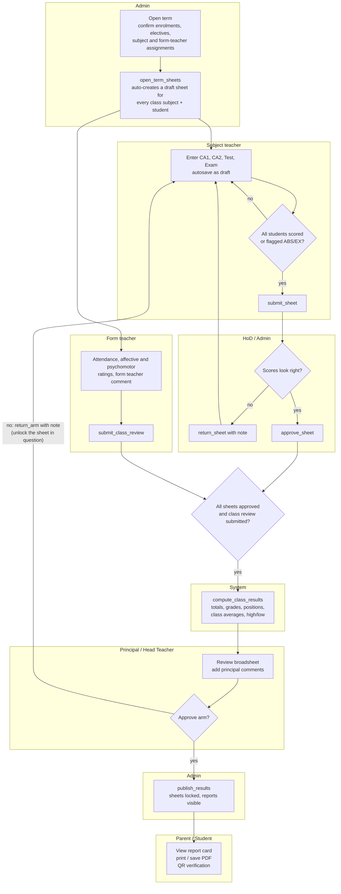
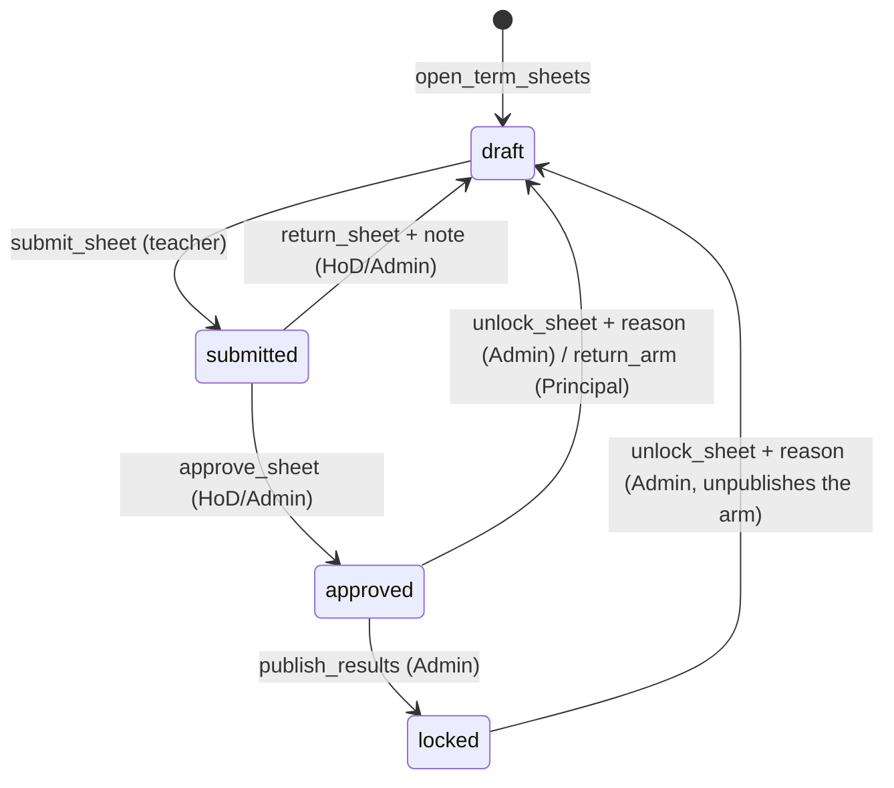
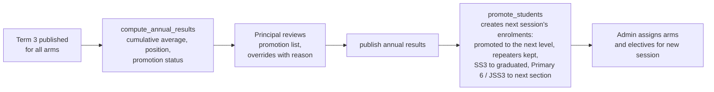

# Result Management System: Implementation Plan

**Scope:** Nursery, Primary (Primary 1–6), Junior Secondary (JSS1–3), Senior Secondary (SS1–3)

**Database:** **PostgreSQL on Supabase**, the same platform as the other apps (Postgres 17). The plan uses Supabase Auth, Row Level Security (RLS), Storage, and Postgres functions or Edge Functions.

**Frontend:** the existing static site on Firebase Hosting. New pages call Supabase through `supabase-js`.

---

## 1. Goals

1. Teachers enter continuous assessment (CA) and exam scores online, per class and subject.
2. The database computes the results the same way every time: totals, grades, subject positions, class positions, averages and annual (cumulative) results.
3. Form teachers add attendance, behaviour ratings and comments. The Head Teacher or Principal approves.
4. The school publishes results by term. Parents and students view them and print or download the report card.
5. The system logs every score change and locks approved results.

**Out of scope for v1:** fees and billing, timetabling, CBT exams, and an SMS gateway. These can come later and fit the same schema.

---

## 2. Current state and decisions

| Finding | Decision |
|---|---|
| The site stores admissions and gallery data in **Firestore** and uses **Firebase Auth** for the admin. | Firebase Hosting, admissions and gallery stay as they are for now. The result system is a separate module on **Supabase Postgres**. Phase 6 can migrate admissions too (optional), so that everything ends up in one database. |
| `firestore.rules` treats *any* signed-in user as admin (`isAdmin()` is `request.auth != null`). | This doesn't affect the new system, because results live in Supabase with their own roles and RLS. It is still a latent risk on the current site, so tighten it (in Phase 0) before anyone other than admins gets a Firebase account. |
| There are two admin codebases: the static `admin-dashboard.js`, which is deployed, and Flask in `engreg-admin/`, which is not deployed. | Build the result screens as static pages using `supabase-js`, in the same style as the deployed admin. Retire `engreg-admin/`. |
| Admins would need two logins (Firebase for admissions, Supabase for results). | This is acceptable for v1. It disappears if admissions migrate to Supabase in Phase 6. |
| Supabase projects on the Free plan **pause after a period of inactivity** and have no automatic backups. | Run the production result system on the **Pro plan** (daily backups, no pausing). Develop on a Supabase branch or a local stack. |

### Why Postgres suits results
Results data is relational: students → enrolments → class arms → subjects → scores. The tricky calculations map onto built-in SQL:
- **Subject and class positions** use `RANK() OVER (PARTITION BY … ORDER BY total DESC)`.
- **Class averages, highest and lowest** use `AVG`, `MAX` and `MIN` over a window.
- **Uniqueness and integrity** use foreign keys, `UNIQUE (term, student, subject)` and `CHECK (score BETWEEN 0 AND max)`. A Firestore document model can't enforce these.
- **Atomic publish and recompute** happen inside a single transaction in a Postgres function.

---

## 3. School rules (configurable data, never hard-coded)

### 3.1 Academic structure
- A **session** (for example 2026/2027) has three **terms**.
- A **section** is one of `nursery`, `primary`, `jss` or `sss`.
- Each **class level** (for example JSS2) has **arms** (JSS2A, JSS2B), and each arm has one **form teacher**.
- **Subjects** are taught per arm by an assigned teacher. In Primary this is usually the class teacher.
- SS students take **elective combinations** (Science, Arts or Commercial), so the subjects each student takes are recorded per enrolment.

### 3.2 Assessment schemes (per section)
| Section | Default components |
|---|---|
| Nursery | Skill ratings (Emerging / Developing / Achieved, or 1–5). A numeric score is optional. |
| Primary | CA1 20 + CA2 20 + Exam 60 = 100 |
| JSS / SSS | CA1 10 + CA2 10 + Test 10 + Exam 70 = 100 *(example, to be confirmed)* |

### 3.3 Grading scales
- **Primary and JSS (example):**
  - A: 70–100
  - B: 60–69
  - C: 50–59
  - D: 45–49
  - E: 40–44
  - F: 0–39
- **SSS (WAEC-style):**
  - A1: 75 and above
  - B2: 70–74
  - B3: 65–69
  - C4: 60–64
  - C5: 55–59
  - C6: 50–54
  - D7: 45–49
  - E8: 40–44
  - F9: 0–39

Each band also has a remark, for example "Excellent" or "Credit".

### 3.4 Computation rules
- **Subject total:** the sum of the component scores. A `CHECK` constraint plus a trigger validates each score against its component maximum.
- **Blank scores:** a blank is *not* treated as 0.
  - **ABS** (absent) counts as 0.
  - **EX** (exempt) excludes the subject from the average.
  - A sheet can't be submitted while any score is still blank without a flag.
- **Per arm, for each subject:** class average, highest, lowest and subject position.
- **Overall:** total, average (total ÷ subjects taken, excluding EX), and position in the arm. Position across the whole level is optional.
- **Ties:** competition ranking (1, 1, 3), using Postgres `RANK()`. Positions are shown as ordinals (1st, 2nd, 11th, 12th, 13th, 21st).
- **Annual (third term):**
  - Cumulative average is the mean of the averages for the terms the student attended.
  - Promotion follows a rule set such as "average ≥ 50 **and** a pass in English and Mathematics".
  - The Principal can override a promotion decision, but must record a reason.
- **Show positions:** a toggle for each section. Many schools hide positions in Nursery and Primary.

### 3.5 Report card content
- **Header:** school name, logo, session and term.
- **Student details:** photo, name, admission number, class, age and gender.
- **Subject table:** each component, total, grade, position, class average, highest, lowest and remark.
- **Overall:** total, average, position, and number of students in the class.
- **Attendance:** days the school opened and days the student was present.
- **Ratings:** affective (behaviour) and psychomotor (skills) ratings.
- **Comments and sign-off:** form teacher's comment, Head or Principal's comment, next term's start date, and a signature or stamp.
- **Verification:** a **QR code** that links to an online verification page.

---

## 4. Architecture

```
Browser (Firebase Hosting, static HTML/JS + supabase-js v2 via CDN)
 ├─ results-admin.html   setup, students, staff, progress, compute, publish, analytics
 ├─ teacher.html         score-entry grid, form-teacher review
 ├─ results.html         parent/student portal, report card view and print
 └─ verify.html          public QR check (name, class, term, average only)
        │ Supabase Auth (JWT carries app role)       │ PostgREST + RLS
        ▼                                             ▼
Supabase Postgres
 ├─ tables: configuration, people, enrolments, raw scores, review inputs
 ├─ snapshot tables: term_reports, term_report_subjects, annual_reports (no client writes)
 ├─ SECURITY DEFINER RPCs (workflow in §5): open_term_sheets, submit_sheet, return_sheet,
 │    approve_sheet, unlock_sheet, submit_class_review, compute_class_results,
 │    approve_arm, return_arm, publish_results, close_term, compute_annual_results,
 │    promote_students, verify_report(code), redeem_result_pin (optional)
 ├─ triggers: score validation, updated_at/updated_by, audit log
 └─ custom access token hook → puts role into the JWT
Supabase Edge Functions (Deno)
 ├─ admin-users     create staff/guardian/student logins (needs the service role key)
 ├─ export-xlsx     broadsheet export (optional; can be done in the browser with SheetJS)
 └─ report-pdf      bulk PDF/ZIP generation (Phase 6, optional)
Supabase Storage
 ├─ student-photos  (private; signed URLs)
 └─ school-assets   (logo, signature, stamp)
```

**Principle:** clients write only **raw inputs**: scores, attendance, ratings and comments. Only `SECURITY DEFINER` functions write the **derived snapshot tables**. RLS gives clients no insert, update or delete rights on them.

Published results are **snapshots**. Changing a grading scale later does not silently alter a report the school has already issued.

---

## 5. Results workflow

This section describes how one term's results move from setup to the parents. The system enforces each step: a status only changes through the RPC listed, and that RPC checks the caller's role and the step's conditions before anything moves.

### 5.1 End-to-end flow (one term)



The two parallel tracks join at the gate **G**:
- Subject teachers enter scores and HoDs approve them.
- Form teachers fill in attendance, ratings and comments.

Form teachers can start their track as soon as the term opens. They don't have to wait for the scores.

### 5.2 Stages, owners and gates

| # | Stage | Who | What they do | Function / RPC | Gate before the next stage |
|---|---|---|---|---|---|
| 1 | **Term setup** | Admin | Open the term. Confirm enrolments, SS electives, subject teachers and form teachers, and set days opened and the next term's start date. | `open_term_sheets(term)` | Every arm has a form teacher, and every class subject has a teacher. Sheets are created for every enrolled student who takes the subject. |
| 2 | **Score entry** | Subject teacher | Enter scores as each CA or exam is done, and mark ABS or EX where needed. The sheet stays in `draft` all term. | Direct upsert (RLS allows only their own `draft` sheets) | No blank cells unless the score is flagged, and every score is ≤ its component maximum. |
| 3 | **Sheet submission** | Subject teacher | Submit the finished sheet. | `submit_sheet(sheet)` | Sheet becomes `submitted` and read-only for the teacher. |
| 4 | **Sheet review** | HoD (secondary) / Head Teacher or Admin (primary) | Check score spread, missing students and obvious errors, then approve or return with a note. | `approve_sheet`, `return_sheet(sheet, note)` | Sheet becomes `approved`, or goes back to `draft` with the note visible to the teacher. |
| 5 | **Class review** | Form teacher | Enter days present, ratings and the form teacher comment (from the comment bank or free text). | Direct upsert on `class_reviews`, then `submit_class_review(term, arm)` | Days present ≤ days opened, and every student has a comment. |
| 6 | **Compute** | Admin (or automatic) | Calculate the arm's results and preview the broadsheet. Re-run freely until publishing. | `compute_class_results(term, arm)` | All sheets `approved` and the class review submitted. The arm becomes `computed`. |
| 7 | **Principal approval** | Principal (secondary) / Head Teacher (nursery & primary) | Read the broadsheet. Add principal comments one by one or in bulk from the comment bank. Approve the arm, or send it back. | `approve_arm(term, arm)`, `return_arm(term, arm, note, sheet_ids[])` | The arm becomes `approved`. Sending it back unlocks only the named sheets. |
| 8 | **Publish** | Admin | Publish one or more arms, or a whole section at once. | `publish_results(term, arms[])` | The arm becomes `published`, its sheets become `locked`, and the reports become visible to families. |
| 9 | **Access** | Parent / Student | View, print or save as PDF. Optionally redeem a PIN. A QR code on the printed card verifies authenticity. | `redeem_result_pin`, `verify_report(code)` | n/a |
| 10 | **Close term** | Admin | Close the term so no more changes can be made, except through the correction path. | `close_term(term)` | All arms `published`. |

### 5.3 Statuses

**Score sheet (`score_sheets.status`)**



**Arm result (new table `arm_results(term_id, arm_id, status, returned_note, approved_by, published_at)`)**

| From | To | Triggered by | Condition |
|---|---|---|---|
| `collecting` | `ready` | System (automatic, via trigger) | All sheets `approved` **and** class review submitted |
| `ready` | `computed` | `compute_class_results` | n/a |
| `computed` | `computed` | `compute_class_results` (re-run) | Still unpublished |
| `computed` | `approved` | `approve_arm` (Principal / Head Teacher) | Every student has a principal comment |
| `computed` / `approved` | `collecting` | `return_arm` | A note is required. The named sheets go back to `draft`. |
| `approved` | `published` | `publish_results` (Admin) | n/a |
| `published` | `collecting` | `unlock_sheet` (Admin) | A reason is required. The arm's reports are unpublished. |

Any change to a score after the arm reaches `computed` sends the arm back to `collecting`. This makes sure no one approves a stale broadsheet.

### 5.4 Corrections after publishing

1. A parent or teacher reports an error to the admin office.
2. The admin runs `unlock_sheet(sheet, reason)`. This sends the sheet back to `draft` and the arm back to `collecting`, and unpublishes that arm's reports. Families see "Result under review".
3. The subject teacher fixes the score and resubmits. The HoD approves.
4. The admin recomputes. The principal re-approves, and the admin republishes.
5. The audit log keeps the before and after values, who made each change, when, and the reason. The report card shows a "Revised on <date>" line.

Only the affected arm is reopened. Other arms stay published.

### 5.5 End of session (after Term 3 is published)



### 5.6 Roles at a glance (RACI)

R = Responsible, A = Accountable, C = Consulted, I = Informed

| Activity | Admin | Subject teacher | HoD | Form teacher | Principal / Head | Parent / Student |
|---|---|---|---|---|---|---|
| Term setup and assignments | **R/A** | I | C | I | C | |
| Score entry and submission | I | **R** | A | | | |
| Sheet approval | C | I | **R/A** | | I | |
| Attendance, ratings, comments | | | | **R** | A | |
| Compute and broadsheet | **R** | | I | I | I | |
| Principal comments and arm approval | | | C | | **R/A** | |
| Publish | **R** | I | I | I | A | I |
| Post-publication correction | **R/A** | R | R | | I | I |
| Annual results and promotion | R | | C | C | **A** | I |

### 5.7 Example timeline for a 13-week term

| When | Milestone |
|---|---|
| Week 1 | Admin completes term setup, and score sheets open. |
| Weeks 2–10 | Teachers enter CA scores as tests are done. The progress tracker shows completion as a percentage per arm. |
| Week 6 | *(Optional)* A mid-term report is published from CA scores alone, using the same flow with exam components hidden. |
| Weeks 11–12 | Exams. Exam scores are due **3 school days** after each paper. |
| Exams + 3 days | All sheets submitted. HoDs have **2 days** to approve or return. |
| Exams + 4 days | Form teachers submit class reviews. |
| Exams + 5 days | Admin computes. The principal has **2 days** to comment and approve. |
| Closing day | Admin publishes. Parents can view the results from that day. |

The tracker highlights overdue sheets. An optional Edge Function sends a daily reminder email to teachers with sheets still in `draft` after a deadline. The school sets the deadlines in `terms`, using the new columns `scores_due`, `review_due` and `publish_on`.
---

## 6. Database schema (PostgreSQL)

All changes are SQL migrations in `supabase/migrations/`, managed with the Supabase CLI and kept in this repo.

### 6.1 People and access
```sql
create type app_role as enum ('admin','principal','hod','teacher','parent','student');

create table profiles (                       -- 1:1 with auth.users
  id uuid primary key references auth.users on delete cascade,
  role app_role not null,
  full_name text not null,
  phone text, staff_no text unique,
  created_at timestamptz default now()
);

create table students (
  id uuid primary key default gen_random_uuid(),
  admission_no text unique not null,
  first_name text not null, middle_name text, last_name text not null,
  gender text check (gender in ('M','F')), date_of_birth date,
  photo_path text, status text not null default 'active'
    check (status in ('active','graduated','withdrawn')),
  user_id uuid unique references auth.users,          -- student login (optional)
  firestore_ref text                                  -- link to admission record
);

create table guardians (
  id uuid primary key default gen_random_uuid(),
  user_id uuid unique references auth.users,
  full_name text not null, phone text, email text
);
create table student_guardians (
  student_id uuid references students on delete cascade,
  guardian_id uuid references guardians on delete cascade,
  relationship text, primary key (student_id, guardian_id)
);
```

### 6.2 Academic configuration
```sql
create table academic_sessions (id serial primary key, name text unique not null,   -- '2026/2027'
  is_current boolean default false);
create table terms (id serial primary key, session_id int references academic_sessions,
  term_no smallint check (term_no between 1 and 3), starts_on date, ends_on date,
  days_opened int, next_term_begins date, status text default 'open',
  scores_due date, review_due date, publish_on date,          -- workflow deadlines (§5.7)
  unique (session_id, term_no));

create table grading_scales (id serial primary key, name text not null);
create table grade_bands (id serial primary key, scale_id int references grading_scales,
  grade text not null, min_score numeric not null, max_score numeric not null,
  remark text, is_pass boolean not null default true);

create table assessment_schemes (id serial primary key, name text not null);
create table assessment_components (id serial primary key,
  scheme_id int references assessment_schemes, code text, label text,
  max_score numeric not null check (max_score > 0), sort_order int);

create table sections (code text primary key,                 -- nursery/primary/jss/sss
  name text, scheme_id int references assessment_schemes,
  scale_id int references grading_scales, show_positions boolean default true);

create table class_levels (id serial primary key, section_code text references sections,
  name text not null, sort_order int);                         -- JSS2
create table class_arms (id serial primary key, level_id int references class_levels,
  name text not null);                                         -- JSS2A
create table subjects (id serial primary key, code text unique, name text not null,
  is_core boolean default true);

create table arm_assignments (                                 -- per session
  session_id int references academic_sessions, arm_id int references class_arms,
  form_teacher_id uuid references profiles, primary key (session_id, arm_id));

create table class_subjects (id serial primary key,
  session_id int references academic_sessions, arm_id int references class_arms,
  subject_id int references subjects, teacher_id uuid references profiles,
  unique (session_id, arm_id, subject_id));

create table enrolments (id serial primary key,
  session_id int references academic_sessions, student_id uuid references students,
  arm_id int references class_arms, unique (session_id, student_id));
create table enrolment_subjects (                               -- SS electives
  enrolment_id int references enrolments on delete cascade,
  class_subject_id int references class_subjects, primary key (enrolment_id, class_subject_id));
```

### 6.3 Raw inputs
```sql
create type sheet_status as enum ('draft','submitted','approved','locked');

create table score_sheets (id serial primary key,
  term_id int references terms, class_subject_id int references class_subjects,
  status sheet_status not null default 'draft', return_note text,
  submitted_at timestamptz, approved_by uuid references profiles,
  unique (term_id, class_subject_id));

create table subject_entries (id bigserial primary key,
  sheet_id int references score_sheets on delete cascade,
  student_id uuid references students,
  flag text check (flag in ('ABS','EX')),
  unique (sheet_id, student_id));

create table component_scores (
  entry_id bigint references subject_entries on delete cascade,
  component_id int references assessment_components,
  score numeric check (score >= 0),            -- trigger enforces <= component max
  updated_by uuid default auth.uid(), updated_at timestamptz default now(),
  primary key (entry_id, component_id));

create type arm_status as enum ('collecting','ready','computed','approved','published');

create table arm_results (                     -- per arm workflow state (§5.3)
  term_id int references terms, arm_id int references class_arms,
  status arm_status not null default 'collecting',
  review_submitted_at timestamptz, returned_note text,
  approved_by uuid references profiles, published_at timestamptz,
  primary key (term_id, arm_id));

create table class_reviews (                   -- per term, per student
  term_id int references terms, student_id uuid references students,
  days_present int, affective jsonb default '{}', psychomotor jsonb default '{}',
  form_teacher_comment text, principal_comment text,
  status text default 'draft', primary key (term_id, student_id));

create table comment_bank (id serial primary key, section_code text references sections,
  min_avg numeric, max_avg numeric, audience text check (audience in ('form','principal')),
  text text not null);
```

### 6.4 Computed snapshots (written only by functions)
```sql
create table term_reports (id bigserial primary key,
  term_id int references terms, student_id uuid references students, arm_id int,
  total numeric, average numeric, subjects_taken int,
  position int, class_size int,
  days_opened int, days_present int, affective jsonb, psychomotor jsonb,
  form_teacher_comment text, principal_comment text,
  published boolean default false, published_at timestamptz,
  verify_code text unique default encode(gen_random_bytes(9),'base64'),
  unique (term_id, student_id));

create table term_report_subjects (report_id bigint references term_reports on delete cascade,
  subject_id int, subject_name text, components jsonb, flag text,
  total numeric, grade text, remark text, position int,
  class_avg numeric, class_high numeric, class_low numeric,
  primary key (report_id, subject_id));

create table annual_reports (session_id int, student_id uuid, term_averages jsonb,
  cumulative_avg numeric, position int, promotion text,  -- promoted/repeat/probation
  override_reason text, overridden_by uuid, published boolean default false,
  primary key (session_id, student_id));

create table audit_log (id bigserial primary key, at timestamptz default now(),
  actor uuid default auth.uid(), action text, table_name text, row_key text,
  before jsonb, after jsonb, reason text);
```

### 6.5 Indexes
Each FK column used in filters (`enrolments(arm_id)`, `subject_entries(student_id)`, `term_reports(student_id)`, `class_subjects(teacher_id)`) gets an index. Run the Supabase **advisors** after each migration to catch missing indexes and RLS gaps.

### 6.6 Core computation (sketch)
`compute_class_results(p_term int, p_arm int)` runs in one transaction:
1. Check that every score sheet for the arm and term is `approved`.
2. Build a CTE of per-subject totals (sum of `component_scores` joined to `subject_entries`). Apply the ABS and EX flags.
3. Add `rank() over (partition by subject order by total desc)`, plus `avg`, `max` and `min` over the same partition.
4. Look up grades by joining `grade_bands` on `total between min_score and max_score` for the section's scale.
5. Per student, compute total, average and `rank() over (order by average desc)`.
6. Upsert into `term_reports` and `term_report_subjects`. This can be re-run until the term is published.

`publish_results(p_term, p_arms int[])` sets `published = true`, sets the matching sheets to `locked`, and writes to the audit log.

---

## 7. Security: Supabase Auth and RLS

- **Roles in the JWT:** a **Custom Access Token Hook** (a Postgres function) copies `profiles.role` into the token's claims. A helper reads it:
  ```sql
  create function app.role() returns app_role language sql stable as
  $$ select (auth.jwt() ->> 'app_role')::app_role $$;
  ```
- **Account creation:** the `admin-users` Edge Function creates staff, guardian and student accounts with the service role key. That key never goes to the browser.
  - Students sign in with an admission number, which the system maps to a synthetic email (`<admission_no>@students.<domain>`), plus a password.
  - Parents sign in with email or phone OTP.
- **RLS on every table.** Representative policies:
  ```sql
  -- Teachers read/write entries only on their own sheets while in draft
  create policy teacher_scores on component_scores for all
  using (exists (select 1 from subject_entries e
           join score_sheets s on s.id = e.sheet_id
           join class_subjects cs on cs.id = s.class_subject_id
           where e.id = entry_id and cs.teacher_id = auth.uid() and s.status = 'draft'))
  with check (same condition);

  -- Admin/principal/HoD read everything
  create policy staff_read on component_scores for select
  using (app.role() in ('admin','principal','hod'));

  -- Parents/students read only published reports of their own children/self
  create policy family_reports on term_reports for select
  using (published and (
     student_id in (select sg.student_id from student_guardians sg
                    join guardians g on g.id = sg.guardian_id where g.user_id = auth.uid())
     or student_id in (select id from students where user_id = auth.uid())));
  -- No insert/update/delete policies on term_reports → only SECURITY DEFINER functions write
  ```
- **Function rules:**
  - Each `SECURITY DEFINER` RPC checks the caller's role first.
  - Each sets `search_path = ''` and uses fully qualified names.
  - `EXECUTE` is revoked from `anon` and `public`.
- **Audit triggers** run on `component_scores`, `subject_entries`, `score_sheets` and `class_reviews`, and record before and after values. `unlock_sheet` requires a reason.
- **Verify page:** an `anon` RPC, `verify_report(code)`, returns only the name, class, term and average. It's rate-limited at the Edge Function or API gateway.
- **Storage:** the student photos bucket is private. Access uses signed URLs, and the same rules as reading the student.
- **Data protection:** the system holds minors' data, so it must comply with the Nigeria Data Protection Act 2023. That means:
  - collect only the data the system needs
  - restrict access by role
  - set a retention rule for withdrawn students
  - show a privacy notice on the portal
- **Backups:** Pro plan daily backups. Take a manual `pg_dump` before each publish window.

---

## 8. User interfaces

### 8.1 Results admin (`results-admin.html`, linked from the existing admin sidebar)
- **Academic setup:**
  - sessions and terms
  - sections, assessment schemes, grading scales and positions toggle
  - class levels and arms
  - subjects and assignments (subject teacher, form teacher)
  - affective and psychomotor traits, and the comment bank
- **Students:**
  - search and filter by class
  - profile and photo
  - **Enrol from admissions:** reads a record from Firestore `*_successful` and inserts into `students`, keeping `firestore_ref` as the link
  - CSV import
  - guardian linking and login creation
  - bulk promote or graduate
- **Staff:** create accounts and set roles.
- **Results:**
  - progress tracker (arms × subjects, coloured by status)
  - approve or return sheets
  - broadsheet preview
  - compute, publish and unpublish
- **Analytics:** subject pass rates, arm averages across terms and top performers (Chart.js, as the existing dashboard uses).

### 8.2 Teacher portal (`teacher.html`)
- **My sheets:** a list with each sheet's status.
- **Score grid:**
  - spreadsheet-style keyboard navigation (Enter, Tab and arrow keys)
  - each cell checked against the component's maximum
  - live total and grade preview, calculated in the browser for display only
  - debounced autosave via upsert, with a warning about unsaved changes
  - CSV download and upload
  - works on a phone in landscape
- **Form teacher:**
  - read-only broadsheet
  - attendance, ratings and comments, with suggestions from the comment bank based on each student's average
  - submit when done

### 8.3 Parent / student portal (`results.html`)
- Log in, then use a child switcher (for parents) and a session and term selector.
- Show the report card, with **Print / Save as PDF** using A4 print CSS.
- Show the annual summary in Term 3.
- **Optional scratch-card PIN mode:** the user enters an admission number and a PIN. The RPC `redeem_result_pin` checks it, counts uses and is rate-limited. PINs are stored hashed.

### 8.4 Report cards and exports
- **v1:** a print stylesheet on `results.html`, with one layout each for Nursery, Primary and Secondary. Print from the browser to PDF. This costs nothing.
- **v2 (optional):** a `report-pdf` Edge Function for bulk class PDFs as a ZIP for the school office.
- **Broadsheet XLSX:** generated in the browser with SheetJS, from a `broadsheet(term, arm)` RPC or view.

---

## 9. Delivery phases

Estimates assume one full-stack developer.

| Phase | Deliverables | Est. |
|---|---|---|
| **0. Foundations** | Create the Supabase project (Pro) and a dev branch, or run the local stack. Add the CLI, the `supabase/` folder and migrations workflow, the custom access token hook, roles, base RLS and pgTAP test harness, and the `admin-users` Edge Function. Tighten `firestore.rules` on the existing site. | 1 wk |
| **1. Setup and students** | Configuration tables and admin screens, student CRUD, CSV import, enrol-from-admissions, enrolments with SS electives, staff and guardian accounts. | 2 wk |
| **2. Score entry** | Score sheets, entries and component scores, validation triggers, the teacher grid with autosave and CSV, the submit/return/approve RPCs, progress tracker and audit log. | 2 wk |
| **3. Computation and review** | `compute_class_results` with pgTAP tests, broadsheet view, form-teacher review, comment bank and principal approval. | 1.5 wk |
| **4. Report cards and publishing** | Snapshot tables, print templates, QR verify page, publish/unpublish/unlock, XLSX export. | 1.5 wk |
| **5. Parent/student portal** | Logins, portal, print, optional PIN mode, rate limits. | 1.5 wk |
| **6. Annual results and consolidation** | Cumulative results, promotion rules and override, roll-over to the next session, analytics, optional bulk PDF. *Optional:* migrate admissions and gallery from Firestore to Supabase and retire Firebase Auth. | 1.5–3 wk |
| **7. Pilot and rollout** | Pilot one Primary arm and one JSS arm on mid-term tests, then teacher training, then go live school-wide for end-of-term exams. | 2 wk (overlaps) |

**Total:** about 11–13 weeks. **Minimum viable release** (phases 0–4, school office prints the report cards): about 8 weeks.

---

## 10. Testing

- **pgTAP (`supabase test db`):**
  - **grading:** grade boundaries (39/40, 49/50, 74/75) and the ABS/EX flags
  - **ranking:** tie positions (1, 1, 3), averages that exclude exempt subjects, and cumulative averages when a term was missed
  - **promotion rules**
  - **status changes:** you can't approve a sheet that still has blank scores, and you can't edit a locked sheet
- **RLS tests** (pgTAP, impersonating each role by setting `request.jwt.claims`) check that:
  - a teacher can't touch another teacher's sheet
  - a parent can't read an unpublished report or another family's child
  - `anon` sees nothing except `verify_report`
- **End-to-end:** Playwright against the local Supabase stack. Admin setup → teacher entry → approve → compute → publish → parent prints.
- **Before go-live:** load one past term's paper results and compare the computed broadsheet line by line with the manual one.
- **Every migration:** run the Supabase security and performance advisors.

---

## 11. Decisions needed from the school

1. Exact **assessment weights** for each section.
2. **Grading scales** and remarks for Primary/JSS and for SSS.
3. Whether to **show positions** in each section, and whether positions are within an arm or across the whole level.
4. **Promotion criteria**, including which subjects a student must pass.
5. Parent access: **free login** or **scratch-card PIN**.
6. Who approves results in each section (HoD, Vice-Principal, Principal or Head Teacher).
7. Report card design: logo, signature or stamp, and optional fields such as a fees notice.
8. **Supabase project:** create a new project in the existing organization, on the Pro plan for production.
9. Whether to migrate admissions and gallery from Firestore to Supabase later (Phase 6), so the school runs on one database.
10. Retire the Flask `engreg-admin/` app.
